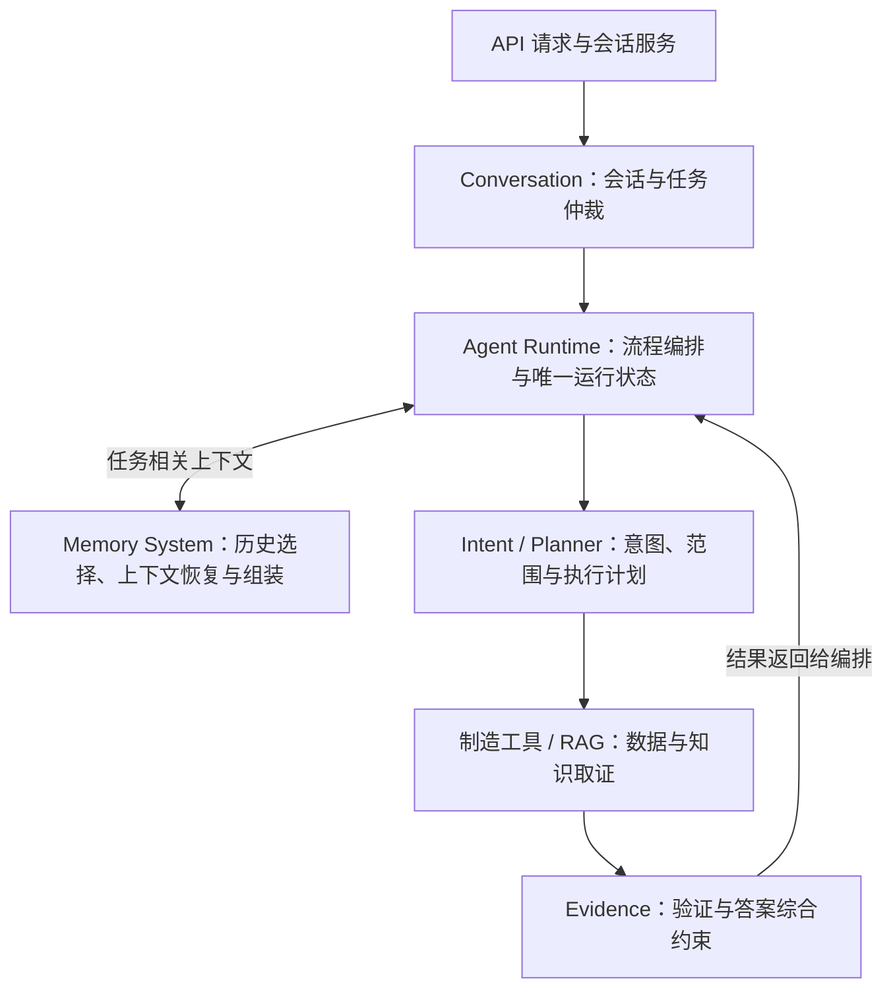

# Memory System 抽离路线与目标项目架构

日期：2026-09-22

状态：2026-09-26 A0—A5 已通过代码、定向回归与完整离线质量门验收；MEM-001—MEM-004 完成，按用户后续要求以单个汇总提交交付。
目标：形成应用内独立的 `app/memory_system/`，先等价收口现有能力，再按需增加当前任务状态。长期记忆为 `OPTIONAL`，暂不实施。不是独立部署服务，不新增框架、向量库或企业级基础设施。

2026-09-22 范围决定：B3 长期记忆保持 `OPTIONAL`，暂不实施、不排期，不作为模块抽离或本期 Memory 能力完成的前置条件。主要考虑生产环境拟采用量化小模型：跨任务召回可能增加上下文长度、语义干扰、条件冲突及多证据关联负担，超出目标模型的可靠处理能力，导致任务理解、条件遵循或推理表现显著下降。此为有研究支持的部署风险，不代表所有量化小模型必然退化，也不是本项目已测得的下降结论。当前优先任务隔离、结构化状态与最小必要上下文；只有目标部署配置通过复杂上下文压力测试后，才评估启用长期经验。

## 1. 完成标准与实施边界

“抽离完成”指：记忆相关协议、历史选择、指代恢复和上下文选择策略有唯一实现及清晰接口；API、Agent 和模型探测不再绕过该接口复制规则；模块能以假存储、假模型、假事件接收器独立测试；原有行为与外部契约保持一致。

字段级任务状态、摘要和失效规则属于后续功能建设，不能通过移动文件宣称完成。长期召回属于另行启用的可选扩展，缺少该能力不影响本期 Memory 验收。

- 第一条线 A0—A5：结构抽离，不改数据库 Schema、HTTP/SSE 契约、上下文窗口、提示词内容及顺序、模型调用次数、超时/重试/Thinking 策略、路由结果和答案约束。
- 第二条线 B1—B2：当前任务内的独立产品迭代，允许经评审的状态模型和行为变化；每项单独验证、单独提交。B3 为 `OPTIONAL`，未经用户明确重新启用不进入执行队列。
- 当前未提交的 `tests/test_context_resolver.py` 改动属于用户已有工作，保留并单独确认归属，不擅自提交或覆盖。
- `AGENT-039` 仍为 OPTIONAL；本规划不自动激活其全部候选范围、不调整 `AGENT-040`～`AGENT-044` 执行队列。实施前再登记任务及排期。

## 2. 职责迁移清单

| 当前入口或符号 | 目标归属 | 处理方式 |
|---|---|---|
| `conversation/context_resolver.py` 的 `ContextResolution` 及相关枚举 | `memory_system/contracts.py` | 保持字段、默认值、序列化和类型身份兼容，旧路径暂时重导出 |
| 上下文 Prompt、JSON 校验及 `build_contextualizer_messages` | `memory_system/context/protocol.py`、`context/history.py` | 唯一协议来源；消息 ID、裁剪顺序、20 条与 16000 字符规则原样迁移 |
| 编号选择、语义 followup/correction/recall、原始消息配对 | `memory_system/context/resolver.py` | 纯解析逻辑迁移；现有最近列表策略先冻结，不夹带修复 |
| `context_system_message` 和主循环最近 8 条历史组装 | `memory_system/context/builder.py` | 收口记忆片段构造；保留角色、顺序、4000 字符截取及原始问题语义 |
| `agent_runtime/preparation/context.py` 的协议解析与纠正 | `memory_system/context/protocol.py` | 格式兼容、一次协议纠正及错误原因码不变 |
| `resolve_conversation_turn` 中的上下文解析用例 | `memory_system/service.py` | 通过注入的模型/事件/时钟端口执行，不直接依赖 HTTP 客户端或运行时状态 |
| `prepare_context_stage` 中的路由准备、模型选择与阶段通知 | 保留 `agent_runtime/preparation/context.py` 薄适配器 | 组装调用条件，将 Memory 结果映射到既有 `ContextStageResult`；不让 Memory 依赖 Agent 类型 |
| `sessions.session_history` 的数据库读取 | 通过 history reader 端口访问既有 Session 存储 | 原函数保留兼容；SQL、归属检查与消息写入仍在 Session；请求只读取一次并复用，避免新增读写竞态 |
| `recover_active_flow`、DecisionArbiter、TurnDecision | 保留 `conversation/` | Memory 返回历史/状态背景；仲裁器拥有活动 Flow 的解释及最终切题权 |
| `CoordinatorRunState` | 保留 `agent_runtime/` | 不整类搬迁；工作状态仍只有一个可变事实源，Memory 按需接收只读投影，不维护另一份可变副本 |
| ready 最终综合输入 | 保留 `agent_runtime/synthesis/ready.py` | 第一阶段只统一记忆输入接口，不把历史新增到原本不带历史的 ready 请求中 |
| `model_gateway/compatibility.py` 的上下文能力探测 | 探测仍在 model_gateway，使用 Memory 纯协议 | 仅允许依赖无副作用的协议/消息构造导出，禁止导入 Memory service；避免反向循环 |
| `agent_runtime/compatibility.py` | 保留为组装与兼容入口 | 接入 Memory service 和端口适配；保留已有 patch 注入语义，而非简单复制函数引用 |
| `assistant_capabilities.py` 的模块映射说明 | 更新到真实 canonical 路径 | 当前可见 `MODULE:app.context_resolver` 旧标识，迁移时审计其消费/测试，不仅做文本替换 |
| Validator、AnswerContract、证据范围与来源规则 | 保留 `evidence/` | Memory 不生成事实验证结论、不接管答案模板或允许结论强度 |
| 文档/案例/个人知识检索与索引 | 保留 `knowledge/`、`personal_knowledge_runtime/` | 长期记忆以后通过检索端口复用，不复制一套 RAG |

## 3. 抽离后的项目组成

下面是 A5 完成时的目标结构，文件职责为建议划分；无实际职责不创建空目录。

```text
app/
├── main.py                       # HTTP 应用入口
├── api/                          # Router、请求服务与依赖组装
├── conversation/                 # 会话生命周期、任务仲裁、TurnDecision
│   ├── sessions.py               # 原始消息与归属、列表/归档/删除
│   ├── decision_arbiter.py        # 最终任务选择与 Flow
│   └── turn_decision.py
├── memory_system/                # 新增：上下文与记忆领域边界
│   ├── __init__.py               # 精简稳定导出，不在导入时初始化存储
│   ├── contracts.py              # ContextResolution、输入输出契约
│   ├── ports.py                  # HistoryReader、ContextModel、EventSink
│   ├── service.py                # 解析上下文及选择记忆的用例
│   └── context/
│       ├── history.py            # 历史选择、预算、可见消息索引
│       ├── resolver.py           # 确定性选择、语义关系与原文回忆
│       ├── protocol.py           # Prompt、JSON 契约与纠正信息
│       └── builder.py            # 按阶段组装记忆上下文片段
├── agent_runtime/                # 编排、阶段适配、工具循环与运行状态
├── intent_runtime/               # 意图与范围解析
├── planning_runtime/             # 执行计划、依赖、预算与查询规划
├── manufacturing/                # 制造能力、Playbook、数据工具
├── knowledge/                    # 正式知识与案例检索
├── personal_knowledge_runtime/   # 个人知识上传、处理和查询
├── evidence/                     # 证据语义、校验与答案综合约束
├── model_gateway/                # 模型连接、流协议、健康与兼容性
├── persistence/                  # SQLite、Schema 与执行记录
├── telemetry/                    # 审计、指标、运行记录
├── core/                         # 配置、身份等公共基础
└── static/                       # 用户端和管理端页面资源
```

旧 `conversation/context_resolver.py` 在 A1—A4 可作为纯兼容转发，A5 按消费者清单退役；有明确外部使用者时保留有期限的转发，不复制业务实现，不重新建立 `app/` 根级旧入口。

### 3.1 逻辑协作架构



该图表示职责协作，不是 Python 导入图，也不是所有请求固定必经的时序。Memory 是与执行编排协作的领域模块，不是所有数据必经的网关。

### 3.2 代码依赖规则

- `memory_system` 核心只依赖标准库和自身模块；外部数据、模型与事件通过端口注入。
- `api` / `agent_runtime` 的组装层实现端口适配：复用 Session、model_gateway 和 telemetry，不把其实现细节写入 Memory。
- Memory 不导入 API Router、Coordinator、Arbiter、Planner、工具 Registry、数据库连接或厂内指标实现；不能调用制造工具来“补记忆”。
- `conversation` 仲裁器可依赖 `memory_system.contracts`，但 Memory 不反向依赖仲裁器。
- model_gateway 的兼容性探测仅可依赖 Memory 无副作用的协议导出；Memory 通过端口调用模型，不导入 gateway，从而不形成循环。
- 端口定义字段需最小化；模型调用阶段的超时/重试策略与网络实现分开，禁止照搬包含大量全局函数的依赖容器成为新公共 API。

## 4. 接口设计原则

以下为目标接口含义，不是已经存在的函数签名：

| 接口 | 输入 | 输出 | 禁止承担的工作 |
|---|---|---|---|
| `HistoryReader.read` | session_id、读取限制；归属沿用现有 Session 请求身份上下文 | 有真实 message_id 的历史及必要 metadata | 绕过 Session 归属检查、全量跨会话检索 |
| `MemoryService.resolve_turn` | 本轮原文、历史快照、模型调用条件、阶段预算 | 兼容 ContextResolution、usage 与降级状态 | 仲裁最终任务、创造业务事实 |
| `ContextModel.complete` | 已构造消息、响应契约、阶段剩余预算 | 最终响应与用量/结束原因 | 持有全局会话或执行制造工具 |
| `ContextBuilder.build` | 阶段标识、解析结果、历史、明确预算 | 按既有行为构造的记忆片段 | 编造 AnswerContract 或改变工具结果 |
| `EventSink.emit` | 事件类型、run_id、受限元数据 | 审计结果 | 记录隐藏思维链或凭据 |

`contextualization`、`agent_loop`、`ready_synthesis` 是不同上下文策略：共用接口不等于共用相同消息列表。路由、计划、证据的 system message 仍由各领域构造，Agent 组装层保持最终顺序。

阶段总 deadline 必须覆盖协议纠正和网络尝试；策略迁移后只有一个预算拥有者，不能 Memory 和 gateway 各自再重试一次。模型选择与熔断仍由既有治理决定，Memory 只接收可用性和执行结果。

## 5. 完整抽离路线

### A0：冻结行为与依赖基线

- 盘点所有静态/动态导入、重导出、patch 点、模型探测、能力目录、测试和文档映射；不能只搜索生产代码。
- 固定输入输出与事件序列：无历史、确定性编号选择、追问、纠正、recall、明确切题、低置信度、协议错、超时、熔断、无模型。
- 固定两套消息窗口及 ready 输入差异；记录数据读取次数、模型调用次数、消息角色/顺序、字段默认值及错误原因码。
- 新增独立 Memory 边界与行为测试基线；当前最近列表歧义测试作为现状记录保留，不在本阶段修复。
- 退出条件：基线可离线复现，未提交用户改动归属明确；没有默认吸收用户修改到重构提交。

### A1：抽离纯契约与解析规则

- 建立 contracts 和 context 纯模块，迁移 ContextResolution、Prompt、JSON 契约、历史选择及指代规则。
- 原 context_resolver 暂时转发到唯一实现；避免多个 dataclass 定义造成 isinstance/序列化差异。
- 保持 `to_dict()` 对回忆正文/候选的过滤规则以及字段默认值，保留已有私有入口兼容需求直到审计完成。
- 退出条件：同输入得到等价解析结果与模型消息，无新增依赖或数据库变化。

### A2：抽离上下文用例，建立端口与适配

- 分解 `preparation/context.py`：Memory 拥有上下文解析协议和纠正策略；Agent 薄适配器拥有阶段编排、路由初判、模型选择及返回包装。
- 注入 ContextModel、EventSink 和可替换时钟；HistoryReader 在 A3 接入 API 唯一历史读取点，保留既有模型健康、重试及 Thinking 行为。
- 生产调用和兼容性探测指向同一纯协议；整理 `compatibility.py` 实时注入，保留现有 mock/patch 契约。
- 退出条件：Memory 可在不启动 FastAPI、不访问数据库、不联网的环境中测试；无 HTTP/gateway/Agent 反向依赖。

### A3：统一历史访问和上下文组装入口

- API 服务仍负责先读取历史、再写入当前用户消息和幂等处理；通过适配器引入读取端口，不新增第二次历史查询。
- 将主循环历史裁剪迁入 context builder；Agent 保留完整模型消息最终拼装。
- ready 阶段使用同一上下文接口的兼容策略，但不新增历史消息、不更改证据负载；后续任务状态才改变其输入。
- 保持旧调用中显式传入 history 的兼容语义，不把服务端 Session 与调用者 history 无条件合并。
- 退出条件：请求 payload、结果、SSE 顺序、缓存命中和查询/模型调用次数与基线一致。

### A4：切换消费者与固化领域边界

- Agent、Conversation、model_gateway 探测、API 注入及测试逐个切到 canonical 导出；更新能力目录和文档。
- 更新 `evaluations/module_boundaries_v1.json` 与 AST 边界检查；加入禁止依赖、动态/相对导入和核心模块导入副作用的反例。
- 更新冻结契约需区别结构路径变化与产品行为变化；第一阶段不得以新快照掩盖行为变化。
- 退出条件：内部没有依赖旧实现的绕行入口、循环导入或重复规则；允许的暂时转发有消费者与退役说明。

### A5：退役兼容入口与完整验收

- 没有内部/约定外部消费者的旧 resolver 转发退役；仍需保留者只转发，不带业务逻辑，并记录明确退出条件。
- 保留 Session 生命周期接口、Agent 阶段适配器和运行状态，它们不是抽离未完成的残留。
- 完整离线门、浏览器会话回归、旧持久化结果读取和重启后历史访问通过；比较 baseline 与候选的上下文成本，不允许新增模型调用。
- 退出条件：目录、职责、边界守卫、兼容清单和文档一致，提交可逐个回退。此时可称“Memory 模块抽离完成”，不能称“长期记忆完成”。

### B1：任务记忆（单独批准的功能迭代）

- 新增 `task_state.py`、`repository.py`（端口），在 persistence 添加最小任务存储实现；扩展版本化迁移，不直接把运行状态序列化成任务记忆。
- 使用 session_id/task_id/revision，保存目标、范围、绝对时间、比较/排除项、回答偏好、待办、来源及确认状态。
- 模型提出字段 patch，Arbiter 确认任务归属后提交；条件变化触发旧证据重评，格式变化不重跑业务工具。
- 建立 pending selection：选项集与来源消息/任务关联；纯文本“第2点”不能只靠任意最近列表认定，歧义行为单独评审与测试。
- 输出要求进入共同任务状态，可供 AGENT-040 消费；不用全量 Memory 作为答案灵活性任务的阻塞条件。
- 验收：纠正、切题、跨日、并发版本冲突、重试幂等、选项归属、旧 Session 默认回退、删除关联处理。

### B2：当前任务内的长会话与有限历史复用

- 新增 `summary.py`、`selection.py`（有实际职责再创建）；保留摘要来源和否定/未决事项，按模型 Token 预算组装。
- 区分历史背景与可重新验证的证据；当前任务范围、口径、新鲜度/数据版本不兼容时重新查询。
- 来源删除与摘要失效联动；不复制现有 tool cache 或绕过证据校验。
- 验收：超窗口条件保持、不串任务、过期结果不作为当前事实、重要条件不被裁剪、延迟与Token对照测量。

### B3：长期记忆候选与受控召回【OPTIONAL，暂不实施】

以下仅保留候选设计，不实现自动长期写入、跨任务召回或经验影响规划的链路，不提前创建 `long_term.py`、长期记忆表或后台沉淀任务。启用需用户明确确认；首先用最终模型、权重与 KV Cache 量化配置通过复杂上下文压力测试，再对照无长期记忆基线评估收益。压力测试方法与证据边界见第 8 节。

现有正式知识/历史案例 RAG、用户主动查看历史记录不受此决定影响；B2 的结果复用限定在当前任务内。跨任务稳定偏好学习也属于 B3，显式应用设置不属于自动记忆。

- 新增 `long_term.py` 负责偏好/案例候选、确认和适用性选择；复用现有知识/案例检索接口，不新增平行 RAG。
- 长期偏好由显式意愿确认；经验保留证据和验证状态；程序经验仅作候选，离线回放与人工确认后才可能更新 Playbook。
- 验收：跨任务召回适用性、来源可追溯、修改/删除传播、不自动把用户反馈当作因果证明、不把重复答案当独立证据。

断点续跑、远程 Memory 服务、跨应用共享、复杂权限平台均不在 A/B 默认范围。需要时另立计划，明确 checkpoint、幂等及副作用处理，不能将执行留痕等同于恢复能力。

## 6. 验证与回退

以下是实施时应执行的命令；各阶段实际结果记录在 [Memory System TODO](todos/memory-system.md)，未执行的验收不视为通过：

```bash
conda run -n fab-insight-agent python -m unittest tests.test_context_resolver tests.test_turn_decision tests.test_agent_preparation_boundaries tests.test_agent_synthesis_boundaries tests.test_ready_plan_execution tests.test_model_connection tests.test_conversation_runtime_module_boundaries tests.test_model_gateway_module_boundaries
conda run -n fab-insight-agent python scripts/check_module_boundaries.py
conda run -n fab-insight-agent python scripts/check_repository.py
conda run -n fab-insight-agent python scripts/run_quality_gate.py full
git diff --check
```

新增 memory_system 的隔离测试和禁止依赖反例也应纳入质量门；HTTP、Session 生命周期及浏览器断言由完整门覆盖并核对其实际执行结果。普通回归不访问真实模型。需要 Live 时单独授权，不把接口可用性当作行为回归通过。

原计划要求每阶段独立提交，顺序 A0→A1→A2→A3→A4→A5；实际已逐阶段验证，用户随后要求提交并同步，故本次以一个汇总提交交付，明确排除用户已有的未提交测试。逐阶段 Git 提交回退未落实，但汇总提交仍可整体反向恢复。A 阶段无 Schema 变化，不删除会话数据。B 阶段使用可向后读取的增量 Schema 与显式回退策略，回退功能不销毁新增数据；兼容适配器必须仍能读取旧 Session/结果。

## 7. 推荐决策

先批准并完成 A0—A5，获得职责独立、行为不变、可单独测试的 Memory System；再以 B1 的任务连续性作为首个产品目标，B2 按需求推进。B3 长期记忆保持 OPTIONAL，不排期、不阻塞验收。不要把架构抽离、答案行为改善、长期学习和数据接口接入合并成一次重构。

与现有任务协调：A3 修改上下文组装处，与 AGENT-040 涉及 ready 输入存在文件交叉；应串行实施，并在后一任务开始前刷新基线。AGENT-041—044 继续归属 evidence/综合逻辑，不迁入 Memory。REF-025 不因本次计划自动激活。

现有 [Memory 设计报告](../presentation/FAB_AI_Assistant_Memory_Design_Report.md) 作为业务设计补充（presentation 被 Git 忽略，该链接只在持有本地材料时可用）；本文件自身包含完整抽离边界与验收要求，不依赖该附件才能执行。

## 8. 量化模型的复杂上下文风险与启用门槛

### 8.1 研究依据及适用边界

- **直接相关的 RAG 实验**：对多个 7B/8B 模型比较 FP16 与 AWQ INT4，增加检索文档至 4K/8K 设置后，量化影响随模型与任务变化。个性化标题生成任务的最大 8K 设置中，Zephyr 的 ROUGE-L 相对下降 18.7%，OpenChat 约下降 1%；部分模型加入过多文档反而退化。该数字不是制造任务准确率，也不是所有量化方法的结论。[论文及表 1](https://arxiv.org/html/2406.10251v1)
- **量化对象须区分**：长上下文评测中，不少模型对 KV Cache 量化比权重量化更敏感，但不同模型结果不同。KV Cache 是推理时的上下文缓存，不是应用 Memory 数据库；仅说明“4-bit 模型”不足以描述实际部署配置。[Evaluating Quantized Large Language Models，第 6 节](https://arxiv.org/html/2402.18158v1)
- **标称窗口不等于有效能力**：RULER 中，简单信息检索表现良好并不保证多信息关联和聚合也可靠，受测模型随上下文长度及任务复杂度增加可明显退化。这不是量化专属实验，不能把全部损失归因于量化。[RULER](https://arxiv.org/html/2404.06654v3)
- **能力下降具有任务差异**：覆盖不同规模指令模型的量化研究发现，部分小模型在 4-bit 下显著退化，但最难任务不一定损失最大；指令遵循等薄弱能力需单独评估。[Exploring the Trade-Offs](https://arxiv.org/abs/2409.11055)

这些实验支持风险存在，不证明本项目最终选用的模型必然或按相同比例退化。上下文复杂度包括长度、信息位置、干扰比例、冲突与多条件推理，不只看 Token 数。长期记录存储量本身不直接增加推理负担，未经控制的召回和注入才是关键入口。

### 8.2 对 Memory 设计的约束

Memory 优先替模型筛选、隔离和组织上下文，而非扩大输入。保留当前任务的有效条件和必要原始依据，历史经验不默认注入；删除不相关内容时不能丢掉否定、最新纠正和未决事项。结构化与压缩同样需要验证，不能假设摘要天然可靠。既有 RAG 继续使用，但也应受相关性和上下文预算控制，不以“不是长期记忆”为由忽略相同风险。

### 8.3 目标配置压力测试

| 控制变量 | 对照方式 | 要识别的问题 |
|---|---|---|
| 模型精度 | 同一模型的 FP16/BF16 与目标量化版本；尽量固定提示、解码与运行条件 | 基础模型能力与量化增量损失 |
| 量化对象 | 分别改变权重与 KV Cache 精度，并测试最终组合 | 不能将缓存量化损失误归因于权重量化 |
| 上下文组织 | 精简任务状态对比完整聊天，逐档增加长度并变换关键信息位置 | 有效上下文范围，而非标称窗口 |
| 干扰与冲突 | 无案例、相关案例、相似但不适用案例、与当前条件冲突案例 | 条件串用、旧结论锚定与纠正失效 |
| 任务复杂度 | 单条件查询、多次纠正、多证据比较与组合过滤 | 不只测试单条信息查找或流畅度 |

业务断言重点覆盖设备/时间串用、排除条件遗漏、最新纠正未生效、旧事实冒充当前证据、错误工具参数及无依据结论。使用固定案例和标准答案，记录逐项失败、Token 与延迟；生成有波动时重复评测，不凭单次样例认定通过。暂不设虚构通过比例，阈值由业务风险及基线结果共同确定。

若无法运行同模型高精度对照，只能报告目标配置的实际可用性，不能声称测得量化造成的净损失。通过压力测试也不自动激活 B3，仍需用户重新确认范围。本次仅记录方法，未执行模型实验。
